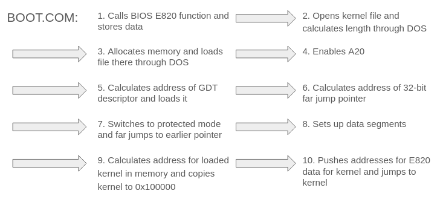
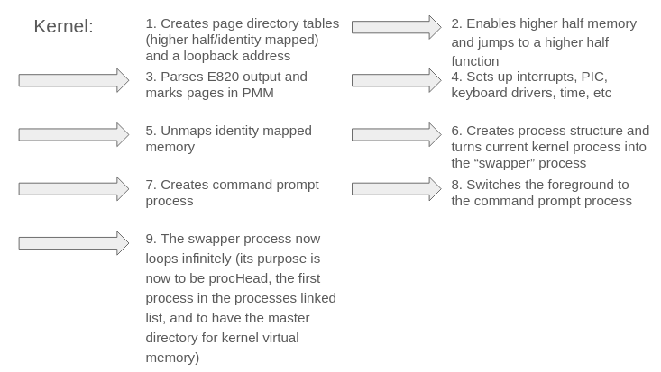
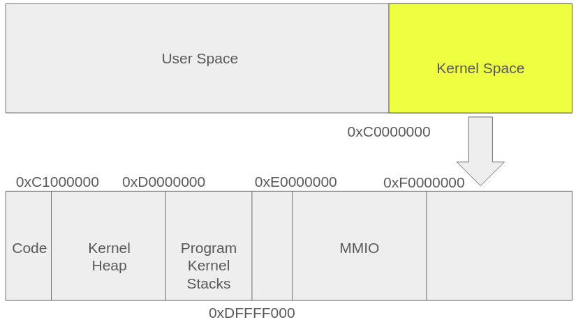
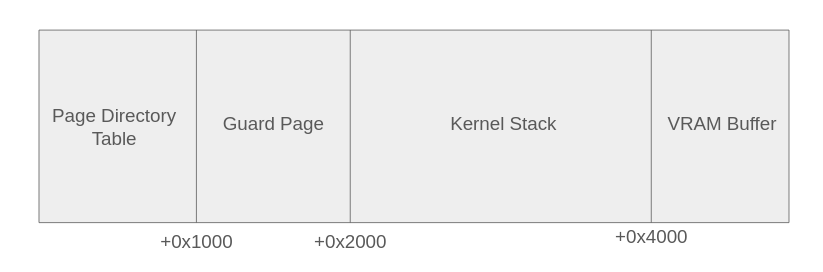
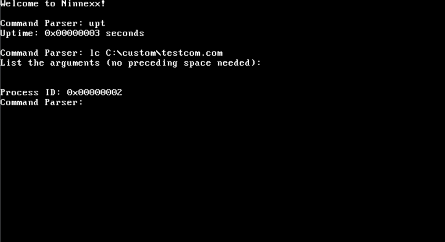

<!-- # Ninnexx
REFORMATTED
A 32-bit protected mode Windows 9x inspired OS kernel with the ability to virtualize certain DOS programs through v8086.
## Features
- DOS program virtualization support through v8086 and INT 21h replication
- Loading through a .COM file from FreeDOS
- Preemptive multitasking with support for switching program views (through Ctrl + Alt + A)
- Native 32 bit userspace APIs 
- FAT support
- PS/2 keyboard support
- Custom command prompt
- Time/sleep subsystem
- Isolated userspaces, even for DOS programs
- E820 compatibility
- Reimplementation of parts of C standard library for kernel level code
- Concurrency, locks

## How to Build

### Requirements
To build this project, you need a **Linux** system with **QEMU, NASM, and GCC** installed and a user account with **administrative priveleges**.

### Steps
1. Download a FreeDOS image and install it onto a .img file on a VM. Name the file **freedos.img** and make sure to create a subdirectory named **Custom** inside of the C:\ directory. Create a folder named "target" in the root directory of this repository (the directory with the subdirectory "src"), and place the image in that folder.
2. While in the main directory, become root (root is needed to mount the FreeDOS image so that the custom code can be transferred to it)
3. Type "make run" and a QEMU window should appear. Choose **Option 5** (Load FreeDOS without Drivers).
4. CD into the Custom folder and run boot.com; the OS should now load! You can run the bundled testcom.com to test DOS compatibility by running "lc C:\custom\testcom.com"

## Controls
### Essential Shortcuts
**Ctrl + Alt + A**: switch to a different program in the foreground

### Commands in Command Prompt

**Note**: this kernel provides minimal commands because its main goal is to be able to virtualize DOS programs and thus there is no need for a lot of user-accessible commands

**lc [filepath]**: load and run a .COM file at the given filepath (arguments will be prompted for after you enter this command). To load the example .COM file, type "lc C:\custom\testcom.com"

**ep [uuid]**: end the process with the given UUID

**upt**: get the uptime of the system in seconds

**clear**: clear the screen -->

<div align="center">

# Ninnexx

*A 32-bit protected-mode Windows 9x-inspired OS kernel with v8086 DOS virtualization.*

---

[](#)
</div>

---

## Features

- **DOS program virtualization**:  through v8086 and INT 21h replication
- **Boostrap from DOS**: Loading through a .COM file from FreeDOS
- **Preemptive Multitasking**: Preemptive multitasking with support for switching program views (through Ctrl + Alt + A)
- **FAT support**
- **PS/2 keyboard support**
- **Custom command prompt**
- **Time/sleep subsystem**
- **Isolated userspaces**: even for DOS programs
- **E820 compatibility**
- **C Standard Library**: Reimplementation of parts of C standard library for kernel level code
- **Concurrency**: locks

---

## How to Build

### Requirements
To build this project, you need a **Linux** system with **QEMU, NASM, and GCC** installed and a user account with **administrative privileges**.

### Steps

1. **Setup FreeDOS Image**
   * Download a FreeDOS image and install it onto a `.img` file on a VM.
   * Name the file **`freedos.img`**.
   * Create a subdirectory named **`Custom`** inside of the `C:\` directory.
   * Create a folder named **`target`** in the root directory of this repository (the directory with the subdirectory `src`), and place the image in that folder.

2. **Become Root**
   * While in the main directory, become root (*root is needed to mount the FreeDOS image so that the custom code can be transferred to it*).

3. **Run the OS**
   * Type `make run` and a QEMU window should appear.
   * Choose **Option 5** (*Load FreeDOS without Drivers*).

4. **Boot Kernel & Test**
   * `cd` into the `Custom` folder and run `boot.com`; the OS should now load!
   * You can run the bundled `testcom.com` to test DOS compatibility by running:
     ```
     lc C:\custom\testcom.com
     ```

---

## Controls

### Essential Shortcuts

| Shortcut | Action |
| :--- | :--- |
| <kbd>Ctrl</kbd> + <kbd>Alt</kbd> + <kbd>A</kbd> | Switch to a different program in the foreground |

---

## Commands in Command Prompt

> **NOTE**: 
> This kernel provides minimal commands because its main goal is to be able to virtualize DOS programs and thus there is no need for a lot of user-accessible commands.

| Command | Description |
| :--- | :--- |
| `lc [filepath]` | Load and run a `.COM` file at the given filepath (arguments will be prompted for after you enter this command). To load the example `.COM` file, type `lc C:\custom\testcom.com` |
| `ep [uuid]` | End the process with the given UUID |
| `upt` | Get the uptime of the system in seconds |
| `clear` | Clear the screen |
## Diagrams
### Boot Process


### Memory Layout

### Per-Process Block


## Images
